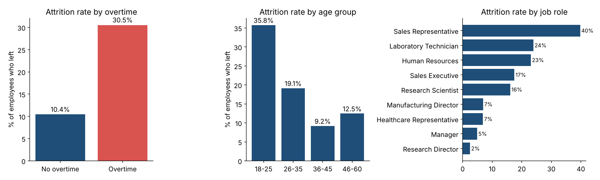

# IBM Employee Attrition: What Makes People Leave?

Exploratory analysis and predictive modelling of employee attrition using the IBM HR Analytics dataset (1,470 employees, 35 fields). The goal is to find which factors are most linked to people leaving, so HR could target retention efforts.

> Companion repo: [IBM-Attrition-Rate](https://github.com/Paulolaide25/IBM-Attrition-Rate) compares three classification models on the same data.



## Business question
Which employee characteristics are associated with attrition, and can we predict who is likely to leave?

## Key findings
- **237 of 1,470 employees (16.1%) left.**
- **Overtime is the strongest signal:** 30.5% of employees working overtime left, against 10.4% of those who did not.
- **Young employees leave most:** 35.8% of 18 to 25 year olds left, falling to 9.2% for ages 36 to 45. Leavers were on average 33.6 years old, against 37.6 for stayers.
- **Pay and tenure matter:** leavers earned a mean monthly income of about 4,787, against 6,833 for stayers, and had about 8.2 total working years, against 11.9.
- **Role and travel:** Sales Representatives (39.8%) and Laboratory Technicians (23.9%) had the highest attrition. Frequent business travellers left at 24.9%, against 8.0% for non-travellers.
- **Single employees left at 25.5%**, against 12.5% for married and 10.1% for divorced.
- A **logistic regression** (pseudo R-squared 0.16) found overtime, environment satisfaction, number of companies worked for, distance from home, age, monthly income and daily rate to be statistically significant at the 5% level.

## Modelling results and limitations
| Model | Accuracy | Precision (leavers) | Recall (leavers) |
|---|---|---|---|
| Random Forest | 0.87 | 0.50 | 0.13 |
| Logistic Regression (scikit-learn) | 0.87 | 0.00 | 0.00 |

Because only about 16% of employees left, accuracy looks high even when leavers are missed. The models mostly predict "stays", so their recall on leavers is low. Handling class imbalance (resampling, class weights, threshold tuning) is the next step. See the companion repo for a model comparison.

## Tools
Python, pandas, seaborn, matplotlib, hvPlot, statsmodels, scikit-learn.

## Repository contents
| File | Description |
|---|---|
| `Employee Attrition Project.ipynb` | Full analysis notebook |
| `IBM.csv` | Source dataset |
| `train_dataset.csv`, `test_dataset.csv` | Train and test splits |

## How to run
```bash
pip install pandas seaborn matplotlib hvplot statsmodels scikit-learn jupyter
jupyter notebook "Employee Attrition Project.ipynb"
```
Run it from the repository folder so `IBM.csv` loads.

*Attrition-rate figures above were calculated from `IBM.csv`; model results come from the notebook output.*
